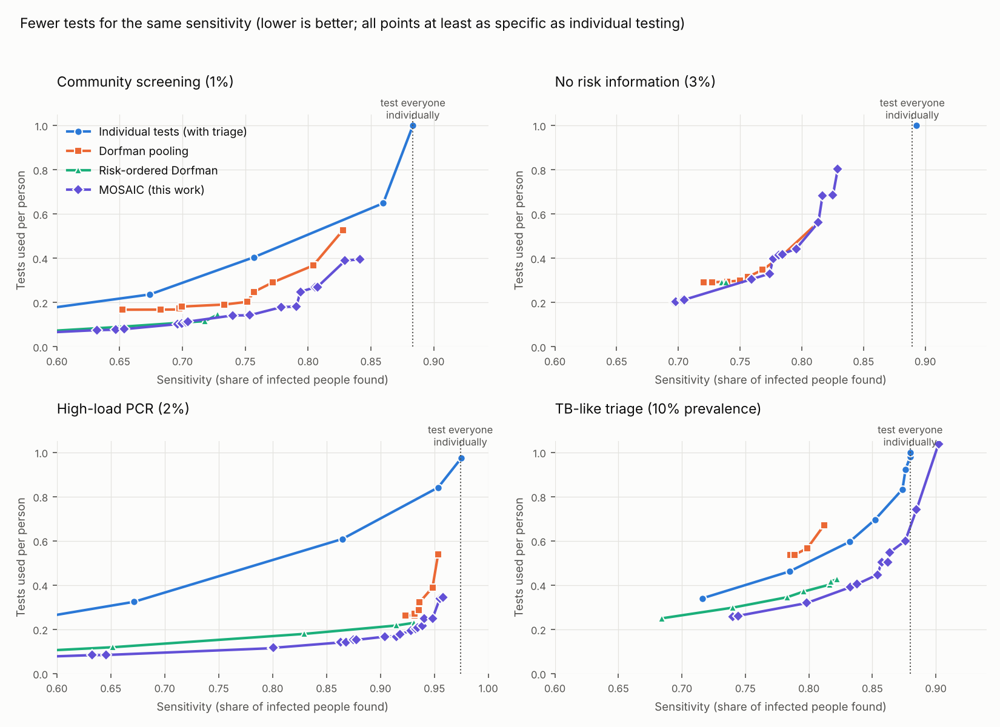

# MOSAIC — risk-aware adaptive pooled testing

**Goal:** find the same number of infected people with far fewer lab tests.

Many diagnostic tests (TB cartridges, HIV viral load, blood-bank screening, STI
PCR, veterinary and food-safety assays) are limited by the cost of each test.
*Pooling* mixes several samples and tests the mix once; if it is negative,
everyone in it is cleared with one test. The classic method (Dorfman, 1943) is
still what most labs use. MOSAIC replaces its fixed recipe with an exact
Bayesian engine that:

1. uses each person's **prior risk** (symptoms, an X-ray AI score, contact status…),
2. models **dilution** (a weak sample can hide in a big pool) and false positives,
3. always picks the next pool that tells it the most, and stops when no one is
   worth another test,
4. can print the result as a **bench card** (a decision tree a technician follows).

> **Status: research prototype, simulation only.** Nothing here has been tested
> on real samples. All populations and assay parameters are synthetic. Do not
> use it for clinical decisions. See "Limits" below.

This folder is self-contained and unrelated to the C# code elsewhere in the repo.

## Headline results (simulation)

Tests used per person to reach a sensitivity target, where the target is a
fraction of what you get by testing **everyone individually**. Every entry is
at least as specific as individual testing. Lower is better. 60,000 simulated
people per scenario, one seed.

| Scenario | Target | Best non-MOSAIC method | MOSAIC | Saving |
|---|---|---|---|---|
| TB-like triage, 10% prevalence, pool ≤ 8 | 100% | 0.98 (triage + individual) | **0.74** | 24% |
| | 97% | 0.83 (triage + individual) | **0.45** | 46% |
| | 90% | 0.37 (risk-ordered Dorfman) | **0.32** | 14% |
| High-load PCR, 2% prevalence, pool ≤ 16 | 97% | 0.39 (Dorfman) | **0.25** | 36% |
| | 94% | 0.23 (risk-ordered Dorfman) | **0.18** | 22% |
| | 90% | 0.22 (risk-ordered Dorfman) | **0.15** | 30% |
| Community screening, 1% prevalence, pool ≤ 16 | 94% | 0.65 (triage + individual) | **0.40** | 39% |
| | 90% | 0.37 (Dorfman) | **0.27** | 27% |
| No risk information, 3% prevalence | 90% | 0.56 (Dorfman, pools of 2) | 0.56 | **none** |



In a noiseless setting the engine uses within 3–5% of the Shannon limit for
prevalence ≥ 5% (Dorfman is 25–50% above it); see `tests/test_core.py`.

### What did *not* work (kept on purpose)

- **No risk information + strong dilution: no gain.** When sensitivity is capped
  by dilution, small pools are already near the best possible and MOSAIC only
  ties Dorfman.
- **Full sensitivity at low prevalence is out of reach for every pooling
  method tried** (community ≥ 97%, PCR 100%): low-load samples are lost when
  diluted. That is physics, not algorithm.
- **First self-improvement attempt failed.** `mosaic/learn.py` fits a value
  function to exact trees and re-plans with it (fitted policy iteration). Scored
  exactly, each generation got *worse* (cost 0.97 → 1.18 → 3.0). It is kept only
  as a record (`results/improve_tb_triage_q0.log`); the working loop is below.
- **A wrong risk model is dangerous.** If the risk score is overconfident,
  MOSAIC skips people it should test: PCR sensitivity fell from 0.89 to 0.52
  (risk-ordered Dorfman: 0.92 to 0.70). Risk scores must be calibrated on local
  data, and should be deliberately flattened if in doubt (costs tests, protects
  sensitivity). See `results/robustness_*.json`.
- **Many rounds.** Tests are chosen one at a time; the TB operating point needs
  about 5 sequential tests per cohort on average. Slow assays need a batched
  variant, which is not built yet.

## Recursive improvement (the version that works)

`experiments/evolve.py` optimises one number, total cost per person in units
of one test: **J = tests + 150 × missed infections + 30 × false alarms**.

- Generation 0: one information-greedy policy for everyone.
- Generations 1–4: for each of ~14 risk bands, mutate the best policies
  (stopping thresholds, pool-size cap, dilution penalty), score **every
  candidate exactly** on its full decision tree, keep the best. About 1,000
  policies are scored exactly per scenario; a generation can never be worse.
- Final: exact one-step lookahead on the first three tests of each cohort,
  kept only in bands where it is exactly better.

The optimiser only sees the decoder's model. Each generation is then re-scored
on the truth simulator (200,000 people), which it never saw:

| Scenario | Exact J: gen 0 → gen 4 → +lookahead | Simulator J: gen 0 → gen 4 → +lookahead | Best baseline (simulator) |
|---|---|---|---|
| High-load PCR | 0.446 → 0.429 → 0.428 | 0.443 → 0.440 → 0.442 | 0.476 (risk-ordered Dorfman) |
| TB-like triage | 2.093 → 2.027 → 2.021 | 2.572 → 2.521 → 2.532 | 2.916 (triage + individual) |
| Community 1% | 0.497 → 0.460 → 0.459 | 0.558 → 0.509 → 0.510 | 0.560 (risk-ordered Dorfman) |

Honest reading:

- In exact scoring the loop improves every generation, by 3–8% in total.
- On the simulator the gain is clear only for community screening (−9%), about
  2% for TB, and within noise for PCR (noise on simulator J is roughly ±0.01
  for PCR and community, more for TB).
- The exact lookahead step adds nothing measurable on the simulator.
- The decoder is optimistic for TB (exact 2.03 vs simulated 2.52): its model of
  the assay is not the simulator's.
- After evolution MOSAIC's total cost is 7% (PCR), 13% (TB) and 9% (community)
  below the best tuned baseline. Before evolution it only tied the baseline in
  community screening.

## How it works

- `mosaic/core.py` — exact posterior over all infection states of a cohort
  (≤ 16 people). Two decoders: a simple one (`Cohort`) and a load-aware one
  (`LoadCohort`) that tracks that a low-load person stays hard to detect on
  retest. The load-aware one is what reaches high sensitivity at low prevalence.
- `mosaic/policy.py` — information-greedy policy, Dorfman baseline, and exact
  evaluation of any policy's decision tree (expected tests, misses, false alarms).
- `mosaic/program.py` — synthetic population with a risk score of chosen
  quality (AUC), truth simulator with persistent per-person loads, baselines,
  and the stratified MOSAIC programme.
- `mosaic/card.py` — prints a bench card (example: `results/example_card.txt`).
- `mosaic/policy.py` `Rollout` — exact lookahead used by the improvement loop.
- `mosaic/learn.py` — the failed first self-improvement attempt (record only).

The decoder never sees the true loads; it only sees test outcomes. The
simulator and decoder use different models on purpose, so results include
model mismatch.

## Reproduce

```bash
pip install numpy matplotlib
cd mosaic
python tests/test_core.py                    # correctness checks (~1 min)
N=60000 python experiments/frontier.py       # all scenarios (~20 min, 4 cores)
python experiments/summarize.py && python experiments/plot.py
python experiments/robustness.py tb_triage 0.012 0.6 0 0.02
N=200000 python experiments/evolve.py community   # improvement loop (~30 min)
```

## Limits (read before believing the table)

- Synthetic everything: load distribution, dilution curve, risk-score quality.
  Real gains depend on real values of these.
- One random seed per scenario and no confidence intervals. The community
  scenario has only ~600 infected people, so its sensitivity is ±1–2 points.
- Repeat tests of the same person are simulated as independent given their
  load. Real repeat tests on one specimen are more correlated, so the
  highest-sensitivity MOSAIC points (which rely on retests) are optimistic.
- Risk-aware pooling itself is not new (informative Dorfman, Bayesian halving
  exist in the literature); I have not done a literature search in this
  session. What is here is an open, exact, tested implementation plus an honest
  benchmark, not a proven breakthrough.
- Baselines were tuned over a grid, not exhaustively.

## Next steps that would matter

1. Fit the load and dilution model to published pooled-assay data.
2. Batched (few-round) policy for slow assays.
3. Built-in safeguards against miscalibrated risk scores.
4. A wet-lab pilot on stored samples with known results.
