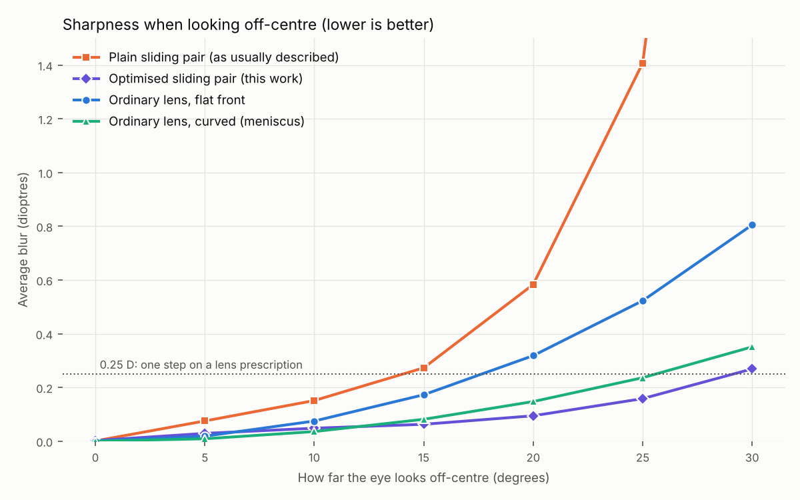

# OpenSight — self-adjustable glasses that also correct astigmatism

**One pair of glasses, three adjustments, no optician and no lens grinding.**
Each eye has two thin moulded plastic plates in a round cell:

| The wearer does this | It changes | Nothing else moves |
|---|---|---|
| slides the plates sideways (x) | near/far-sightedness (sphere), −6 to +3 D | yes |
| slides them up/down (y) | amount of astigmatism, 0 to 3 D of cylinder | yes |
| turns the round cell | direction (axis) of the astigmatism | yes |

> **Status: an optical design verified by exact ray tracing. Nothing has been
> built.** The mechanism (slides, cell, frame) is not designed. No person has
> looked through it. See "Limits".

This folder is self-contained and unrelated to the other projects in the repo.

## Why this matters

- Hundreds of millions of people lack glasses mainly because there is no one
  nearby to prescribe and make them. Self-adjustable glasses exist to solve
  that, and trials show self-adjustment works for sphere.
- But the products on the market correct **sphere only**. Published reviews
  and trials name uncorrected astigmatism as their main failure: in one trial
  in children, higher astigmatism raised the odds of not reaching 20/25 about
  tenfold.
- Astigmatism of 1 D or more affects about 13% of adults in a German
  population study, 26% of over-40s in an Argentine one, and about half of
  over-60s in an Iranian one.

## What is and is not new

- **Not new:** the sliding cubic plates (Alvarez, 1967), and the idea that a
  second slide direction plus a rotation gives astigmatism (it appears in a
  patent, and a 2018 lab study used it).
- **What this work adds:** a complete, open, optimised optical prescription
  for such a lens, with the off-centre image quality that the plain design
  lacks, plus tolerances and shape files. I did a short literature check, not
  a full one, so some of the optimisation ideas below may already be published.

## The result

Average blur as the eye looks off-centre, over prescriptions from −6 to +3 D
with up to 3 D of cylinder (4 mm pupil, exact ray tracing):

| Looking off-centre by | 0° | 10° | 20° | 30° |
|---|---|---|---|---|
| Plain sliding pair (textbook shape) | 0.00 | 0.15 | 0.58 | 4.49 |
| **Optimised pair (this work)** | 0.00 | **0.05** | **0.09** | **0.27** |
| Ordinary lens, flat front (sphere only) | 0.00 | 0.08 | 0.32 | 0.81 |
| Ordinary lens, curved front (sphere only) | 0.00 | 0.04 | 0.15 | 0.35 |

Units: dioptres of blur; 0.25 D is one step on a prescription. Worst case for
the optimised pair: 0.15 D at 20°, 0.49 D at 30°.



Two changes produce this:

1. **Perspective matching.** Every line of sight fans out from the eye's
   centre of rotation, so it crosses the two plates at slightly different
   points. Making the rear plate a ~1% smaller copy of the front one lines the
   two shapes up along every line of sight.
2. **Higher-order shape terms** (4th to 7th order, 20 numbers in all) found by
   numerical optimisation. They cancel when the plates are centred and act
   only when slid, removing blur that grows with prescription strength.

Checks beyond the table:

- **Independent cases:** 150 random prescriptions and gaze directions (within
  20°) that the optimiser never saw: mean blur 0.04 D, worst 0.13 D.
- **Knobs really are independent:** sliding 2 mm in y adds 1.5 D of
  cross-cylinder and changes sphere by under 0.01 D (`results/report.json`).
- **Fine detail:** higher-order aberrations stay under 0.5 arcminute within
  20° (20/20 detail is 1 arcminute); up to 1.2 arcminutes at 30°.
- **Tolerances** (60 random builds: 0.5% shape mismatch, 0.1 mm gap, 0.3°
  plate rotation, 0.5° tilt, index ±0.002, wearer setting errors of 0.05 mm
  and 3° of axis): blur averaged over the ±20° field is under 0.20 D in 95% of
  builds; the worst point in the field is under 0.34 D in 95%.
- **Buildable shape:** each plate is 1.4–3.5 mm thick over a 34 mm window;
  slides are ±3 mm per plate for sphere and ±1 mm for cylinder; the facing
  surfaces keep at least 0.2 mm clearance at every setting.

## Files

- `opensight/optics.py` — exact ray tracer and spectacle-style power measurement.
- `opensight/design.py` — the lens model; `load()` rebuilds the final design.
- `experiments/optimize.py` — shape optimisation (`WIDE=1` for the final design).
- `experiments/report.py`, `experiments/tolerance.py` — the numbers above.
- `results/design_A0.000635_gap1_wide.json` — the final design.
- `results/plate_coefficients.json`, `results/*_sag_mm.csv` — plate shapes for a mould maker.
- `tests/test_optics.py` — five checks, all passing.

```bash
pip install numpy scipy matplotlib
cd opensight
python tests/test_optics.py
WIDE=1 python experiments/optimize.py 6.35e-4 1.0     # ~9 min
python experiments/report.py results/design_A0.000635_gap1_wide.json
python experiments/tolerance.py results/design_A0.000635_gap1_wide.json 60
```

## Limits

- **Not built.** Ray tracing of smooth plastic surfaces is very reliable, so I
  am confident the optics behave as computed *if the plates are made to
  shape*. Whether a mould can hold these freeform shapes at low cost is not
  shown; the tolerance test covers only simple error types, not real mould
  error maps.
- **No mechanism.** Two slides and a rotating cell per eye, small and cheap
  and holding position to 0.05 mm, still has to be designed. This may be the
  hardest part.
- **No human test.** Whether people can set three adjustments well by
  themselves is unproven. Finding the astigmatism axis is harder than
  focusing; it will need a simple target (for example a line chart) and a
  trial.
- **Comparison lenses are simplified** (parabolic surfaces, one curved form),
  not the best commercial lenses.
- **One colour, one eye geometry.** Colour fringing is not computed (it should
  be similar to any polycarbonate lens of the same power). The eye's rotation
  centre is fixed at 27 mm behind the lens; fit variation is not tested.
- **Range and size.** Sphere −6 to +3 D, cylinder to 3 D, 34 mm round lenses.
  Stronger prescriptions and prism are not covered. Round lenses are needed
  for the rotating cell.

## Path to a real product

1. Have an optics group or mould maker review the design and re-trace it in a
   commercial tool (a day's work with the coefficient file).
2. Diamond-turn one prototype pair and measure it on a lens mapper.
3. Design the slide-and-rotate cell; test wearer self-adjustment against a
   standard eye exam in a small study.
4. Only then: tooling, a field trial, and regulatory clearance.

## Sources

- Self-adjustable glasses and astigmatism in children (trial summary): https://www.aao.org/education/editors-choice/self-refraction-with-adjustable-focus-spectacles-m
- Self-refraction of sphero-cylindrical errors with Alvarez lenses (2018): https://pmc.ncbi.nlm.nih.gov/articles/PMC5947140
- Patent describing a second slide direction plus rotation: https://patents.google.com/patent/US7325922
- Astigmatism prevalence, Gutenberg Health Study: https://pubmed.ncbi.nlm.nih.gov/28823075/
- Astigmatism prevalence, Villa Maria Eye Study: https://ri.conicet.gov.ar/handle/11336/98010
- Astigmatism in the elderly, Tehran Geriatric Eye Study: https://bvbvf1.bib-bvb.de/vufind/PrimoRecord/cdi_proquest_miscellaneous_2700639013
